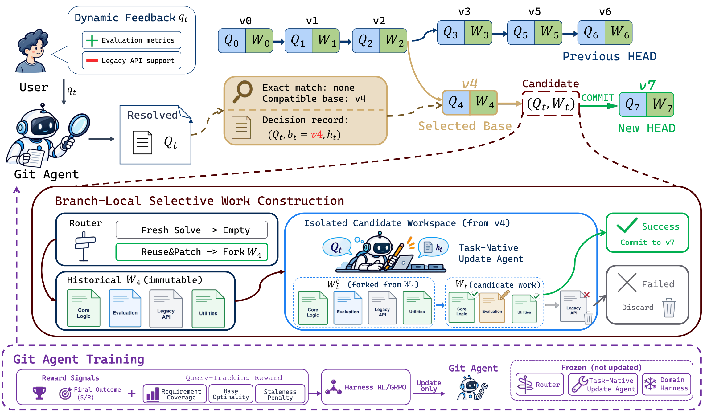

# GitHarness

[](LICENSE)
[](pyproject.toml)

GitHarness gives multi-turn agents Git-like version control for evolving user
requirements. A **Git Agent** maintains complete requirement versions, a
**canonical StackPlanner root** creates the initial **State 0**, and a
**Task-Native Update Agent** updates accepted work without restarting every turn.

The repository includes the five task-native domains used by MTAgentBench:
Math, SQL, Search, Research, and Code.

## Key Features

- **Requirement versioning** — `Inspect`, `Commit`, and `Reuse` actions maintain
  complete, auditable user requirements.
- **Branchable execution** — every accepted requirement is bound to an immutable
  workspace checkpoint in the Version Graph.
- **State 0 bootstrap** — the canonical StackPlanner root performs the initial
  full solve and creates the first reusable task state.
- **Incremental updates** — later turns can patch an accepted checkpoint, start
  from an empty candidate, or reuse an exact historical version.
- **Five task-native domains** — one runtime covers Math, SQL, Search, Research,
  and Code while preserving their native tools and artifacts.
- **Separated evaluation** — generation uses public task inputs; private answers,
  tests, databases, and graders stay on the evaluation side.

## Method Overview



The figure shows branch-local work construction after an accepted version
exists. For the initial version, the canonical StackPlanner root performs the
full solve and creates State 0 before the same finalization and commit boundary.
The lower panel shows Git Agent training with the companion Harness-RL project;
the Router, Task-Native Update Agent, and domain harness remain frozen during
that training workflow.

GitHarness separates requirement reasoning from task execution:

1. **Git Agent** converts the newest feedback and Version Graph context into a
   complete resolved requirement. It selects a base version and chooses Commit
   or exact Reuse.
2. **canonical StackPlanner root** handles the first full solve. Its finalized
   artifact, plan, and work state become State 0 and checkpoint `C0`.
3. **Task-Native Update Agent** works only inside an isolated candidate. It can
   update a checkpoint fork or solve a later independent requirement from an
   empty candidate.
4. **Branch Execution** finalizes successful candidates and binds them to the
   Version Graph. Failed candidates are discarded without changing accepted
   history.

The three public execution modes are:

| Mode | Starting point | Execution |
|---|---|---|
| `FreshSolve` | Empty candidate | StackPlanner root for State 0; Update Agent for later independent versions |
| `ReuseAndPatch` | Fork of an accepted checkpoint | Task-Native Update Agent |
| `ExactReuse` | Accepted historical version | Restore its artifact and checkpoint directly |

GitHarness supports turn-by-turn `eager` execution and
`deferred_necessary_path`. The deferred schedule is intended to accelerate
large-scale Harness-RL rollout sampling: it resolves the conversation first and
materializes only the versions required by the selected path (plus any artifacts
explicitly requested through `Inspect`), avoiding unnecessary Branch Execution. Both
schedules use the same Git Agent, Version Graph, and execution components.

## Installation

The setup script creates `.venv` and installs GitHarness, development tools,
YAML support, and the canonical StackPlanner dependencies:

```bash
cd GitHarness
scripts/setup.sh
source .venv/bin/activate
```

Code evaluation can optionally install the SWE-bench package:

```bash
WITH_SWE=1 scripts/setup.sh
```

## Quick Start

### Configure a model

Copy the environment template and fill in the providers required by the domains
you want to run:

```bash
cp .env.example .env
```

At minimum, an OpenAI-compatible model needs:

```bash
LLM_BASE_URL=https://your-openai-compatible-host.example/v1
LLM_API_KEY=replace-me
```

The example configs use Git Agent step budget `4` and Update Agent step budget
`16`. The five Bash entry points load `.env` automatically:

```bash
scripts/run_math.sh
scripts/run_sql.sh
scripts/run_search.sh
scripts/run_research.sh
scripts/run_code.sh
```

Set `CONFIG`, `OUTPUT`, or `PYTHON_BIN` to override a script default. For example:

```bash
OUTPUT=.runs/math-example scripts/run_math.sh
```

## Supported Domains

| Domain | StackPlanner graph | Artifact | Evaluation | Additional environment |
|---|---|---|---|---|
| [Math](datasets/math/README.md) | `sp_math` | `answer.md` | Normalized exact match | None |
| [SQL](datasets/sql/README.md) | `sp_sql` | `answer.sql` | BIRD execution accuracy | BIRD database for evaluation |
| [Search](datasets/search/README.md) | `sp_search` | `answer.json` | BrowseComp normalized EM | Retrieval service and corpus assets |
| [Research](datasets/research/README.md) | `sp_deep_research` | `report.md` | DeepResearch Bench RACE | `BOCHA_API_KEY` and private RACE assets |
| [Code](datasets/code/README.md) | `sp_swe` | `patch.diff` | Official SWE-bench grader | Docker and official task images |

Search exposes a narrow `search(query)` capability. Code runs commands only in
the isolated `/testbed` workspace with container networking disabled. SQL
generation receives the public question, schema, and evidence and produces SQL;
database execution belongs to evaluation.

## Datasets and Evaluation

Public MTAgentBench cases are under [`datasets/`](datasets/README.md). Math and
SQL provide train, validation, and test splits; Search, Research, and Code
provide test splits. [`datasets/registry.json`](datasets/registry.json) indexes
the public files and their SHA-256 fingerprints.

Each domain README explains the required upstream data and environment:

- [Math dataset](datasets/math/README.md)
- [SQL dataset and BIRD environment](datasets/sql/README.md)
- [Search dataset and retrieval assets](datasets/search/README.md)
- [Research dataset and BoCha setup](datasets/research/README.md)
- [Code dataset and SWE-bench environment](datasets/code/README.md)

Validate the packaged public cases or run the five-domain offline boundary
smoke with:

```bash
scripts/datasets.sh validate
scripts/datasets.sh smoke
```

Evaluation is a separate command and opens private records only after generation:

```bash
mtagentbench evaluate \
  --predictions .runs/predictions.jsonl \
  --private-records .local/mtagentbench/math/private_eval.jsonl \
  --output .runs/evaluation
```

The evaluator registry uses normalized exact match for Math, BIRD execution for
SQL, BrowseComp normalized exact match for Search, the official four-dimensional
DeepResearch Bench RACE protocol for Research, and the official SWE-bench grader
for Code. Research is reported as a continuous RACE score rather than binary
accuracy; the separate FACT metric is not reported.

## Training with Harness-RL

The companion Harness-RL project can be cloned next to GitHarness for training
and large-scale rollout experiments:

```text
workspace/
├── GitHarness/
└── Harness-RL/
```

Harness-RL consumes GitHarness handoffs, trajectories, checkpoint bindings, and
evaluation results through the versioned compatibility export. GitHarness can
also be installed and run independently for inference.

## Project Structure

```text
GitHarness/
├── src/githarness/          # Git Agent, State 0, execution, and versioning
├── src/mtagentbench/        # Dataset validation and task evaluators
├── vendor/stackplanner/     # Canonical StackPlanner snapshot
├── datasets/                # Public MTAgentBench cases and domain guides
├── examples/                # Five-domain runtime configurations
├── schemas/                 # Versioned public serialization contracts
├── scripts/                 # Setup and runnable Bash entry points
└── tests/                   # Deterministic and fake-backed tests
```

## Development

```bash
PYTHONPATH=src:. python -m pytest -q
python -m ruff check src tests
scripts/datasets.sh validate
scripts/datasets.sh smoke
```

Generated runs belong under `.runs/`; locally installed benchmark assets belong
under `.local/`. Keep credentials in the ignored `.env` file.

## License

GitHarness is released under the [Apache-2.0 license](LICENSE). Third-party
licenses are retained next to the corresponding vendored code or public data,
including canonical StackPlanner, GSM8K, BIRD, BrowseComp, DeepResearch Bench,
and SWE-bench materials distributed by this repository.
